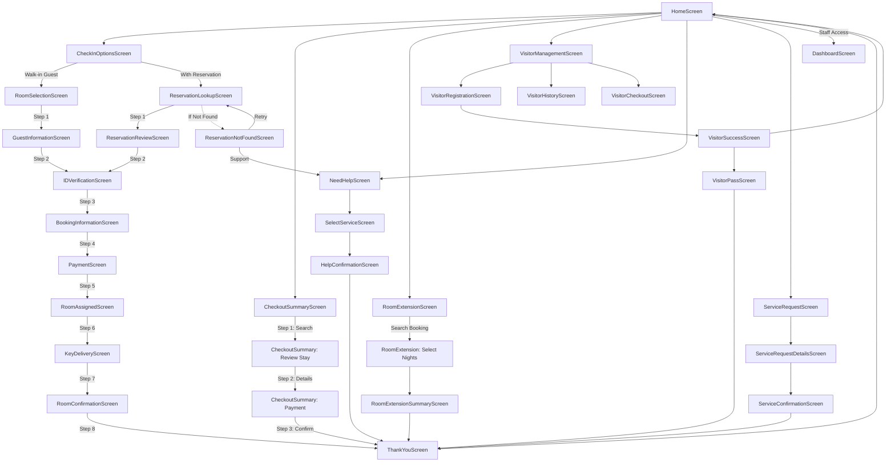

# Royal Inn - Hotel Self-Service Kiosk (Frontend)

[](https://reactnative.dev/)

[](https://expo.dev/)
[](https://www.typescriptlang.org/)
[](https://reactnavigation.org/)

A professional, self-service hotel kiosk application designed for lobby deployment. Built with **React Native**, **Expo SDK 56**, and **TypeScript**, the kiosk enables incoming guests to seamlessly check in, purchase walk-in stays, verify their identity documents, make payments, retrieve room keys, order additional guest services, register visitors, extend their stay, request help, and check out without waiting in lines.

This repository represents the frontend of the Royal Inn Hotel Self-Service Kiosk. It communicates with a Node.js + Express backend through REST APIs, while Supabase serves as the application's database.

---
## 🔗 Repositories

### Frontend Repository
https://github.com/PriyanshiG-HUB/hotel-kiosk-frontend

### Backend Repository
https://github.com/PriyanshiG-HUB/hotel-kiosk-backend

---

## 📖 Table of Contents

1. [Repositories](#-repositories)
2. [Features](#-features)
3. [Project Highlights](#-project-highlights)
4. [Frontend Architecture](#-frontend-architecture)
5. [Technology Stack](#️-technology-stack)
6. [Application Screens](#-application-screens)
7. [Complete Navigation Flow Diagram](#-complete-navigation-flow-diagram)
8. [Folder Structure](#-folder-structure)
9. [Installation](#️-installation)
10. [Running the App](#-running-the-app)
11. [Environment Setup](#-environment-setup)
12. [Building the APK](#-building-the-apk)
13. [Backend Integration](#-backend-integration)
14. [Localization Support](#️-localization-support)
15. [UI Components](#-ui-components)
16. [Future Enhancements](#-future-enhancements)
17. [License](#-license)
18. [Author](#-author)

---

## 🌟 Features

*   **Dual Check-In Methods**: Accommodates both pre-booked reservations (searched via Booking ID, mobile, or email) and walk-in guests.
*   **Structured 8-Step Check-In Pipeline**: Walks guests through a clear step-by-step progress flow from room selection to key card dispensing.
*   **Visitor Management Portal**: Allows guests to register new visitors, generate QR-based digital visitor passes, view visit history, and check visitors out.
*   **Room Extension Flow**: Lets guests look up their active bookings and pay to extend their checkout date.
*   **On-Demand Service Requests**: Enables in-house guests to request amenities (towels, blankets, dining, toiletries) categorized by department.
*   **Need Help & Support Dispatch**: Connects guests directly to hotel staff by creating priority support tickets from the kiosk.
*   **Self-Checkout Flow**: Processes outstanding balances and completes checkout operations instantly.
*   **Multi-lingual Localization**: Fully translated UI with support for English, Hindi, Arabic, and French, dynamically adjusting styles for various language defaults.
*   **Kiosk Status Dashboard**: A built-in dashboard for hotel administration to monitor system statistics (active bookings, active visitors, room occupancy) and local kiosk hardware health status (Internet, printer, card reader, and scanner connectivity).

---

## 🚀 Project Highlights

- 📱 31+ React Native screens
- ⚛️ Built with React Native, Expo SDK 56, and TypeScript
- 🔗 REST API integration with Express backend
- 🗄️ Supabase database integration
- 🏨 Dual Check-In workflow (Walk-In & Reservation)
- 💳 Self-service payment and check-out
- 👥 Visitor Management with QR Code Visitor Pass
- ⏳ Room Extension functionality
- 🍽️ Guest Service Requests
- 🆘 Need Help support module
- 🌍 Multi-language support (English, Hindi, Arabic & French)
- 📊 Administrative Dashboard

---

## 🏗️ Frontend Architecture

The frontend follows a highly structured, scalable architecture designed for high reliability in public terminal environments:

1.  **State Machines & Multistep Layouts**: The application coordinates complex state transitions through sequential steps using a centralized state pattern. Walk-in and reservation-based flows converge cleanly at the **ID Verification** step.
2.  **API-Driven Architecture**: The frontend follows an API-driven architecture where the backend acts as the single source of truth. Business data such as bookings, guests, rooms, payments, visitors, room extensions, and service requests is retrieved and updated through REST APIs. Route parameters are used for passing temporary screen data, while language preferences are managed separately.
3.  **Modular Component Hierarchy**: UI elements are divided into discrete, reusable presentation nodes (`Button`, `Input`, `Header`, `StepIndicator`, `RoomCard`, `PaymentCard`, `StatusCard`, `DashboardCard`) styling elements according to the project design tokens.
4.  **Centralized Design System**: Spacing, colors, border-radii, shadows, and typography are defined systematically under `src/theme/` to maintain aesthetic consistency and allow fast style updates.

---

## 🏛️ System Architecture

```text
+----------------------+
| React Native (Expo)  |
+----------+-----------+
           |
           | REST APIs (Axios)
           v
+----------------------+
| Node.js + Express    |
+----------+-----------+
           |
           | Database Queries
           v
+----------------------+
| Supabase PostgreSQL  |
+----------------------+
```

---

## 🛠️ Technology Stack

*   **Framework**: [Expo SDK 56](https://expo.dev/) (supporting React Native `0.85.3`)
*   **Language**: [TypeScript](https://www.typescriptlang.org/) (~`6.0.3`) for robust compile-time safety and self-documenting code.
*   **Navigation**: [React Navigation 7](https://reactnavigation.org/) (`@react-navigation/native` & `@react-navigation/native-stack`) utilizing typed stack parameters.
*   **Storage**: `@react-native-async-storage/async-storage` for local persistence of settings like selected languages.
*   **HTTP Client**: `Axios` (`^1.18.1`) configured with platform-aware host-address lookup for seamless API requests.
*   **Vector Icons**: `@expo/vector-icons` (`Ionicons`) for visual consistency.
*   **Vector Drawing & QR Generator**: `react-native-svg` and `react-native-qrcode-svg` for rendering sharp vector designs and generating readable guest/visitor passes.
*   **Effects & Gradients**: `expo-linear-gradient` and `react-native-reanimated` for premium UI visuals, micro-animations, and smooth transition animations.

---

## 📱 Application Screens

The frontend codebase is composed of **31+ application screens** located under `src/screens`, categorized into the following flows:

### 🏨 Main Landing & Admin
*   **Home**: The primary kiosk interface displaying the main action options (Check-in, Check-out, Room Extension, Visitor Management), localized language quick-switching buttons, need help/service buttons, and kiosk hardware status indicators.
*   **Dashboard**: Administrative and staff dashboard used to monitor system statistics (active bookings, active visitors, available rooms) and live kiosk hardware connectivity.

### 📥 Walk-In Check-In Flow (8 Steps)
1.  **RoomSelection**: Room browser displaying card lists of rooms (Deluxe, Premium, Suite) with live availability, rates, and amenities.
2.  **GuestInformation**: Intake form capturing full name, mobile number, email, nationality, ID type, and ID number.
3.  **IDVerification**: Interactive screen instructing the user to insert their ID document into the physical scanner, displaying a scanning simulator.
4.  **BookingInformation**: Layout showing guest and room details for final review.
5.  **Payment**: Kiosk payment screen offering simulated checkout methods (Credit/Debit Card, UPI, or Pay Later).
6.  **RoomAssigned**: Displays the guest's assigned room number, room orientation, and details.
7.  **KeyDelivery**: Screen indicating the physical key card is being written to and dispensed from the kiosk's keycard slot.
8.  **RoomConfirmation**: Final success screen showing check-in completion, offering receipt printing options, and transitioning to a Thank You screen.

### 🔍 Reservation Check-In Flow (8 Steps)
1.  **ReservationLookup**: Search portal allowing guests to retrieve pre-booked stays by Booking ID, Mobile Number, or Email.
2.  **ReservationReview**: Displays the retrieved reservation details to the guest for confirmation.
3.  **IDVerification**: Verification process (converges with Walk-In flow).
4.  **BookingInformation** -> **Payment** -> **RoomAssigned** -> **KeyDelivery** -> **RoomConfirmation**: Common check-in paths (Steps 4 to 8).
*   *Fallback Screens*: **ReservationNotFound** offers error handling and redirects back to search or details assistance.

### 📤 Check-Out Flow
*   **CheckoutSummary**: Handles the three checkout stages: (1) booking search, (2) reviewing stay details and additional room service charges, and (3) processing outstanding payments before concluding the stay and printing the check-out receipt.

### 👥 Visitor Management Flow
*   **VisitorManagement**: Router screen directing visitors to registration, active logs, or checkout.
*   **VisitorRegistration**: Form collecting visitor details, host room, host guest name, and purpose of visit.
*   **VisitorSuccess**: Confirms successful check-in and provides navigation to print passes.
*   **VisitorPass**: Renders a printable pass displaying visitor details and a secure QR code for building entry.
*   **VisitorCheckout**: Facilitates visitor checkout by searching by phone number or pass ID.
*   **VisitorHistory**: Provides history logs of checked-in and checked-out visitors.

### ⏱️ Room Extension Flow
*   **RoomExtension**: Search screen for active bookings to initiate an extension.
*   **RoomExtensionSummary**: Displays selected additional nights, updated checkout dates, added charges, and logs the change.

### 🍽️ Guest Service Requests Flow
*   **ServiceRequest**: Category selector for housekeeping, maintenance, dining, and hotel amenities.
*   **ServiceRequestDetails**: Service catalog allowing guests to adjust quantities and add requests.
*   **ServiceConfirmation**: Confirms receipt of request and lists dispatch information.

### 🆘 Need Help / Support Flow
*   **NeedHelp**: Category grid to select help topics (e.g., Key Card Issue, Room Cleanliness, Luggage Assistance).
*   **SelectService**: Form capturing additional details or text-notes for staff.
*   **HelpConfirmation**: Success confirmation page showing ticket status and arrival estimation.

---

## 📊 Complete Navigation Flow Diagram

The following state transition diagram illustrates how screens navigate, showing the convergence of both walk-in and reservation processes:



---

## 📂 Folder Structure

```text
hotel-kiosk-frontend/
│
├── assets/                     # Images, icons, and static assets
│
├── src/
│   ├── api/                    # Axios API services
│   │   ├── api.ts
│   │   ├── bookingApi.ts
│   │   ├── checkoutApi.ts
│   │   ├── dashboardApi.ts
│   │   ├── guestApi.ts
│   │   ├── helpApi.ts
│   │   ├── paymentApi.ts
│   │   ├── roomExtensionApi.ts
│   │   ├── serviceApi.ts
│   │   └── visitorApi.ts
│   │
│   ├── components/             # Reusable UI components
│   │   ├── Button/
│   │   ├── Header/
│   │   ├── Input/
│   │   ├── LanguageSelector/
│   │   ├── PaymentCard/
│   │   ├── RoomCard/
│   │   ├── StatusCard/
│   │   ├── DashboardCard/
│   │   └── StepIndicator/
│   │
│   ├── context/                # Global contexts (Language, Help, Service)
│   │
│   ├── hooks/                  # Custom React hooks
│   │
│   ├── locales/                # Translation files
│   │   ├── en.ts
│   │   ├── hi.ts
│   │   ├── ar.ts
│   │   └── fr.ts
│   │
│   ├── navigation/             # React Navigation configuration
│   │
│   ├── screens/                # Application screens
│   │   ├── Check-In
│   │   ├── Check-Out
│   │   ├── Visitor Management
│   │   ├── Room Extension
│   │   ├── Guest Services
│   │   ├── Need Help
│   │   └── Dashboard
│   │
│   ├── theme/                  # Colors, Typography, Spacing, Shadows
│   │
│   ├── types/                  # TypeScript interfaces and types
│   │
│   └── utils/                  # Utility functions
│
├── App.tsx                     # Root application component
├── app.json                    # Expo configuration
├── index.ts                    # Entry point
├── package.json                # Project dependencies
├── tsconfig.json               # TypeScript configuration
├── README.md                   # Project documentation
└── LICENSE                     # MIT License
```
---

## ⚙️ Installation

To run this application locally, ensure you have **Node.js (v18+)** installed.

1.  **Clone the Repository**:
    ```bash
    git clone https://github.com/PriyanshiG-HUB/hotel-kiosk-frontend.git
    cd hotel-kiosk-frontend
    ```

2.  **Install Dependencies**:
    ```bash
    npm install
    ```
### Backend Requirement

This frontend communicates with the backend through REST APIs. Ensure the backend server is running before starting the frontend.

```bash
git clone https://github.com/PriyanshiG-HUB/hotel-kiosk-backend
cd hotel-kiosk-backend
npm install
npm run dev
```
---

## 🚀 Running the App

Start the Expo local development server:

```bash
npm start
```

### Development Server Controls
Once the server starts, you can run the app using the following commands:

*   **Android Emulator**: Run `npm run android` or press `a` in the terminal (requires Android Studio emulator to be active).
*   **iOS Simulator**: Run `npm run ios` or press `i` in the terminal (requires Xcode simulator, macOS only).
*   **Web Browser**: Run `npm run web` or press `w` in the terminal.
*   **Physical Mobile Device**: Install the **Expo Go** application on your Android/iOS device and scan the QR code displayed in your terminal.

---

## 🌐 Environment Setup

The application communicates with the backend APIs via the Axios configurations in `src/api/api.ts`. 

```typescript
export const api = axios.create({
  baseURL: Platform.OS === "web" ? "http://localhost:5000/api" : "http://10.0.2.2:5000/api",
});
```

*   **Web Host**: Connects directly to `localhost:5000`.
*   **Android Emulator Host**: Connects to the host machine through `10.0.2.2:5000`.
*   **Physical Device / Production Kiosk Host**: If running Expo Go on a physical phone, modify the baseURL IP address to point to the local network IP address of your running backend server (e.g., `http://192.168.1.XX:5000/api`).

---

## 📦 Building the APK

To bundle the application into a standalone Android package (`.apk`), use Expo Application Services (**EAS Build**):

1.  **Install EAS CLI**:
    ```bash
    npm install -g eas-cli
    ```

2.  **Log in to Expo Account**:
    ```bash
    eas login
    ```

3.  **Configure Build Profiles**:
    ```bash
    eas build:configure
    ```

4.  **Build Android Preview (APK)**:
    Make sure your `eas.json` configuration has a profile set with `"buildType": "apk"`. Run:
    ```bash
    eas build --platform android --profile preview
    ```

---

## 🔌 Backend Integration

API communication is managed by modular service calls under `src/api/` mapping to backend endpoints:

| API Service | Endpoint Path | Action | Description |
| :--- | :--- | :--- | :--- |
| `bookingApi` | `/rooms` | `GET` | Fetches available hotel rooms |
| `bookingApi` | `/bookings/search/:mobile` | `GET` | Looks up booking details by customer mobile number |
| `bookingApi` | `/bookings/:id` | `GET` | Retrieves full details of a specific booking ID |
| `bookingApi` | `/bookings` | `POST` | Creates a new booking reservation in the database |
| `guestApi` | `/guests` | `POST` | Registers a new guest profile (nationality, ID documents) |
| `paymentApi` | `/payments` | `POST` | Logs transaction amount, status, and method |
| `roomExtensionApi` | `/room-extensions` | `POST` | Requests stay extension for active bookings |
| `checkoutApi` | `/checkout` | `POST` | Marks booking as checked out, freeing the room |
| `visitorApi` | `/visitors` | `POST` | Registers a visitor check-in to a room |
| `visitorApi` | `/visitors/checkout` | `POST` | Logs visitor checkout status |
| `serviceApi` | `/service-requests` | `POST` | Orders housekeeping or dining amenities |
| `helpApi` | `/help/help-requests` | `POST` | Registers support/assistance tickets for staff dispatch |
| `dashboardApi` | `/dashboard` | `GET` | Retrieves Kiosk system status metrics |

---

## 🗣️ Localization Support

The app has built-in localization configurations. The default vocabulary mapping directories are located in `src/locales/`:
*   `en.ts` (English)
*   `hi.ts` (Hindi - हिन्दी)
*   `ar.ts` (Arabic - العربية)
*   `fr.ts` (French - Français)

### Technical Details
*   **Context API Management**: The selected locale is loaded and updated using `LanguageContext.tsx`.
*   **Local Persistence**: Language selections are saved in device storage using `@react-native-async-storage/async-storage` so the application retains preferences upon reboot.
*   **Translation Hook**: Components translate content dynamically using the custom `useTranslation` hook:
    ```typescript
    const { t } = useTranslation();
    return <Text>{t('welcome')}</Text>;
    ```

---

## 🧩 UI Components

Custom UI components under `src/components/` adhere to the global style themes:

*   **Button**: Contains `PrimaryButton` (solid design for primary actions) and `SecondaryButton` (bordered design for return/secondary actions) styled with flexible sizing and state feedback.
*   **Input**: `CustomInput` wraps native text entries, supporting custom icons, security toggle features for passwords/sensitive codes, and clean state styles.
*   **Header**: Standard header containing title labels and a clean return button that integrates with navigation stacks.
*   **StepIndicator**: Renders a progress indicator bar mapping steps completed versus remaining steps.
*   **RoomCard**: Display component for room selection layouts, illustrating price tags, images, room titles, and key amenities.
*   **PaymentCard**: Selector displaying payment methods (Card, UPI, Pay Later) with custom visual indicators.
*   **StatusCard**: Admin card listing hardware items with a status dot indicator (Connected/Offline).
*   **DashboardCard**: Administrative grid card presenting metrics (Active Bookings, Visitors, Rooms) with premium typography.

---

## 🚀 Future Enhancements

*   **Native Hardware SDK Integrations**:
    *   Integrate actual OCR passport and driver's license ID scanning via native device camera modules.
    *   Integrate local thermal printer drivers to print receipt slips and paper visitor passes.
    *   Connect keycard writer modules (RFID/NFC chip encoders) via native bridging interfaces to program keys.
*   **Real-time Support Chat**: Implement WebSocket connections for immediate direct messaging between the Kiosk user and hotel front-desk staff.
*   **Biometric Identity Verification**: Add facial recognition matching to cross-check scanned IDs against live camera feeds.
*   **True Payment SDK Integration**: Embed Stripe, Google Pay, Apple Pay, and native UPI payment gateway SDKs directly into the check-out forms.

---

## 🤝 Contributing

Contributions, feature requests, and bug reports are welcome.

Please fork the repository, create a feature branch, commit your changes, and submit a pull request.

---

## 📄 License

This project is licensed under the MIT License.

See the LICENSE file for details.

## Author

## 👨‍💻 Author

**Priyanshi Gajiwala**

B.Tech Information Technology

GitHub:
https://github.com/PriyanshiG-HUB

LinkedIn:
https://www.linkedin.com/in/priyanshi-gajiwala-1b00b7323/